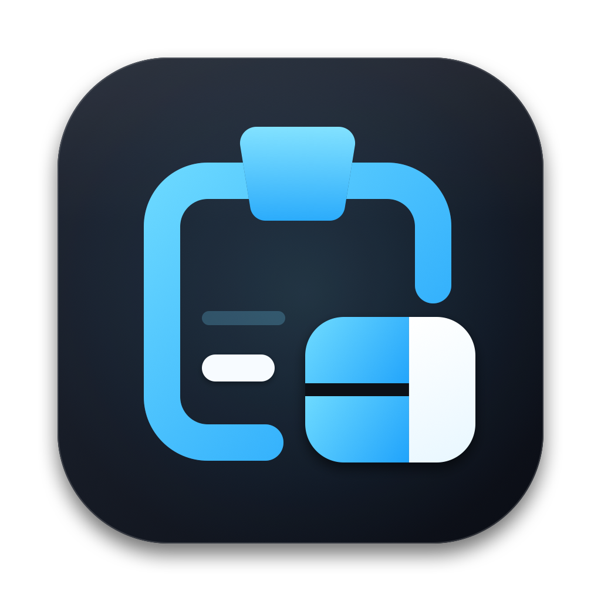
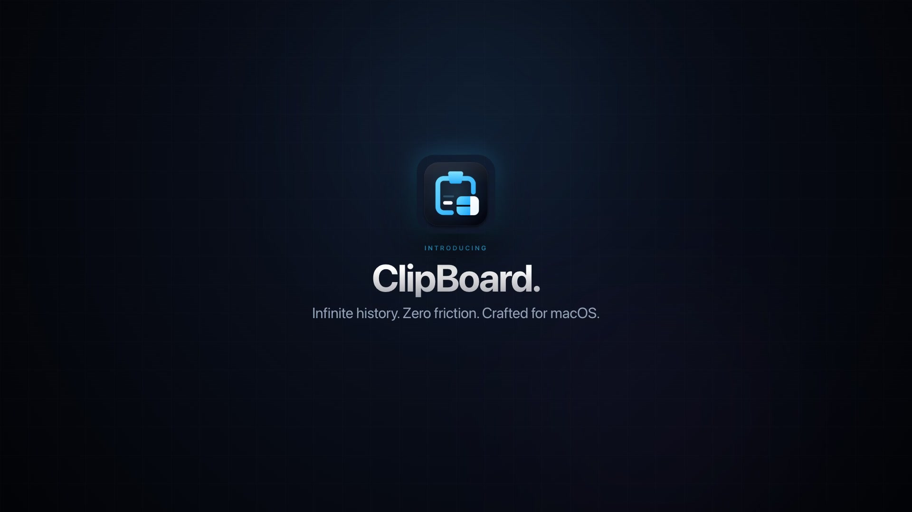
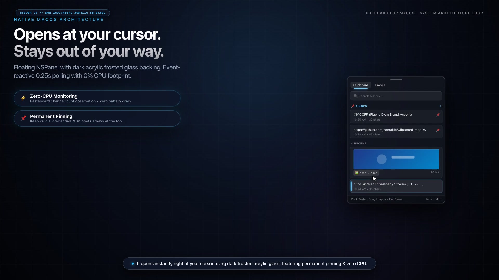
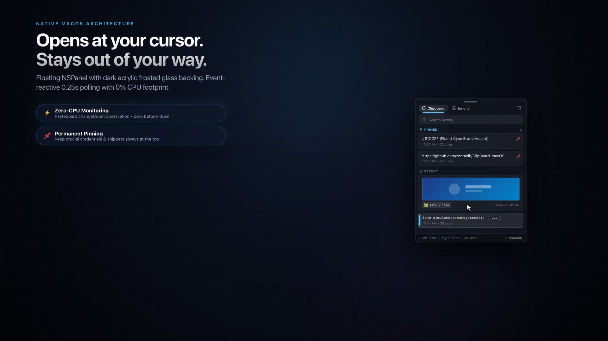
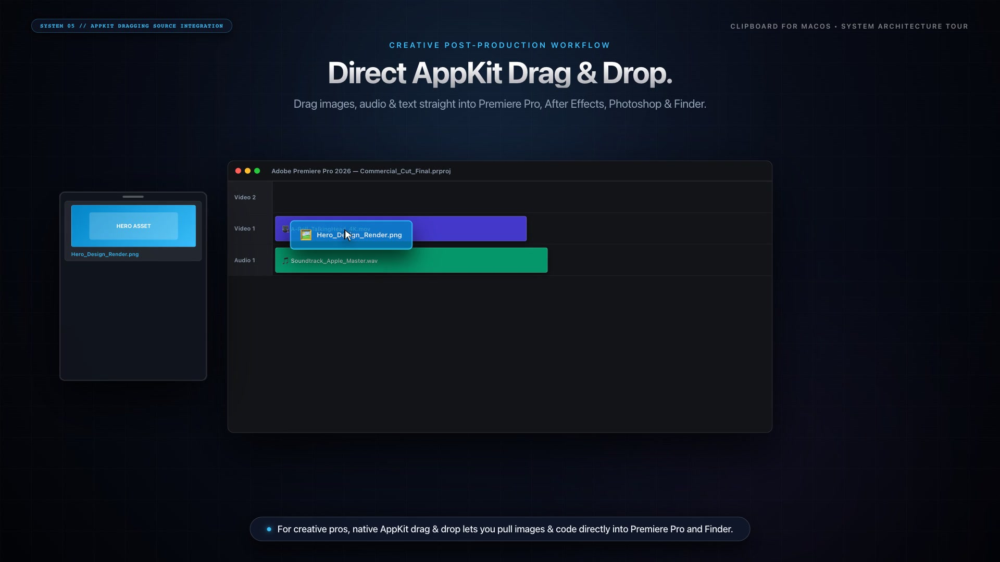

<div align="center">



# ClipBoard for macOS

**Windows 11 `Win + V` style Clipboard History & Emoji Launcher for macOS.**  
*Lightweight. Zero CPU Overhead. Native Drag & Drop into Pro Video & Design Apps.*

[](LICENSE)
[](https://swift.org)
[](https://apple.com/macos)
[](#)
[](#)

<br/>



</div>

---

## 🌟 Overview

**ClipBoard** brings the beloved Windows 11 `Win + V` clipboard manager experience to macOS with Apple-native elegance and power-user performance.

Designed specifically for developers, video editors, designers, and writers, ClipBoard runs silently in the background as a lightweight menu bar utility with **0% idle CPU usage**, instant keyboard shortcuts, auto-paste, favorite pinning, an integrated emoji picker, and **seamless drag-and-drop support directly into timeline apps like Adobe Premiere Pro, After Effects, DaVinci Resolve, Photoshop, and Figma**.

---

## ✨ Key Features

### ⚡️ 1. Instant Global Hotkeys
- **`⌥V` (Option + V)** or **`⌘⇧V` (Cmd + Shift + V)** triggers the floating launcher right under your mouse pointer or at your preferred window position.
- Press `Escape` or click anywhere outside to dismiss smoothly.

### 🚀 2. Intelligent Auto-Paste
- Click any copied item from the list, and ClipBoard will automatically hide itself, restore focus to your previous application, and synthesize a native paste keystroke (`⌘V`) without manual intervention.

### 📌 3. Pinning & Favorites
- Pin your most important code snippets, boilerplate text, commands, or color codes so they stay permanently saved at the top.
- Pinned items are saved locally in persistent JSON storage (`~/Library/Application Support/ClipBoard/pinned.json`) and are never erased when clearing history or reaching the buffer limit.

### 🎨 4. Native Drag & Drop (Pro App Support)
- Don't just paste — **drag and drop!**
- Drag any copied screenshot or image directly into:
  - **Adobe Premiere Pro** & **After Effects**
  - **DaVinci Resolve**
  - **Adobe Photoshop** & **Illustrator**
  - **Figma**
  - **Slack**, **Discord**, **WhatsApp**, **Finder**, and Web Browsers
- Images are automatically formatted with `public.file-url`, `NSFilenamesPboardType`, and calibrated sRGB PNG representations for maximum compatibility across both creative apps and messaging clients.

### 😊 5. Integrated Emoji Launcher & Unicode Search
- Instant access to categorized emojis (Smileys, Gestures, Animals, Food, Objects, Symbols).
- Full Unicode keyword search + conversational aliases (e.g. searching *"love"* finds ❤️, *"lol"* finds 😂, *"fire"* finds 🔥, *"pizza"* finds 🍕).
- Horizontal mouse wheel navigation and smooth category scrolling.

### 🔒 6. Strict Privacy & Zero CPU Footprint
- **Zero-Polling CPU Overhead**: Uses event-driven change count observation (`NSPasteboard.changeCount`). Idles at **0.0% CPU**.
- **Password Manager Protection**: Automatically detects and ignores sensitive clipboard payloads from password managers and secure inputs (including `org.nspasteboard.ConcealedType`, `com.agilebits.onepassword`, `de.keepassx`, `net.antelle.keeweb`). Your passwords and OTPs are never stored in clipboard history.

### 🪟 7. Draggable Floating HUD
- Custom sleek drag handle at the top allows effortless window repositioning across multiple monitors.
- Window position persists smoothly during your working session.

---

## 📸 Screenshots

| Clean Clipboard History | Full Emoji Grid & Search |
| :---: | :---: |
|  |  |

| Native Drag & Drop into Timeline |
| :---: |
|  |

---

## 📥 Installation

### Method 1: Ready-to-Use Installer (Recommended)
1. Download `ClipBoard-Installer.zip` from the latest [GitHub Releases](https://github.com/zenrakib/ClipBoard/releases).
2. Unzip the file and double-click `Install.command` (or drag `ClipBoard.app` to your `/Applications` folder).
3. Grant **Accessibility** permissions when prompted (required for simulating `⌘V` auto-paste and global hotkeys).
4. Press `⌥V` (Option + V) and enjoy!

### Method 2: Build From Source

#### Prerequisites
- macOS 13.0 (Ventura) or later
- Xcode 15+ or Command Line Tools (`xcode-select --install`)
- Swift 5.9+

#### Clone & Build
```bash
# Clone the repository
git clone https://github.com/zenrakib/ClipBoard.git
cd ClipBoard

# Build debug executable
swift build

# Run the app directly
swift run ClipBoard
```

#### Create Standalone Universal .app Bundle
To compile a universal release binary (`arm64` for Apple Silicon + `x86_64` for Intel) and package it into `ClipBoard.app`:
```bash
./bundle_app.sh
```

The script will compile, bundle, and ad-hoc sign `ClipBoard.app` with icons and metadata. You can launch it with:
```bash
open ClipBoard.app
```

---

## 🧪 Testing

The repository includes a comprehensive 15-point test suite covering change-count guards, password manager suppression, deduplication, capacity management, pin persistence, and drag & drop export:

```bash
swiftc -o run_tests Sources/ClipBoard/ClipboardMonitor.swift Tests/ClipBoardTests/ClipboardMonitorTests.swift
./run_tests
rm run_tests
```

**Expected output:**
```
========================================
Running ClipboardMonitor Test Suite...
========================================
✓ Test 1 Passed: ChangeCount guard exits immediately (zero CPU overhead)
✓ Test 2 Passed: Strict suppression of all concealed & credential pasteboard types
✓ Test 3 Passed: Plain text extraction, whitespace trimming, and empty check
✓ Test 4 Passed: Deduplication and recency promotion
✓ Test 5 Passed: In-memory stack capped at exactly 50 items
✓ Test 6 Passed: Copying back to pasteboard syncs changeCount without recursion
✓ Test 7 Passed: Lifecycle methods, start/stop monitoring, and clear stack
✓ Test 8 Passed: Image / screenshot capture, downscaled thumbnail, deduplication & copy
✓ Test 9 Passed: Pin toggle switches isPinned state
✓ Test 10 Passed: Pinned items saved to JSON and reloaded successfully
✓ Test 11 Passed: clear() removes unpinned items while strictly preserving pinned items
✓ Test 12 Passed: Capacity overflow skips pinned items and evicts oldest unpinned item
✓ Test 13 Passed: Deduplication preserves isPinned status
✓ Test 14 Passed: Image Drag & Drop exports persistent PNG and provides FileURL + NSFilenamesPboardType + PNG
✓ Test 15 Passed: Text & Emoji Drag & Drop provides plain string payload
========================================
✓ ALL TESTS PASSED SUCCESSFULLY!
========================================
```

---

## 🏗 Architecture & Code Structure

```
ClipBoard/
├── Sources/
│   └── ClipBoard/
│       ├── ClipBoardApp.swift         # App entry point, MenuBarExtra, status item, lifecycle
│       ├── ClipboardView.swift        # SwiftUI UI (History list, Emoji grid, Search, Header)
│       ├── ClipboardMonitor.swift     # Core pasteboard monitor, caching, deduplication, drag writer
│       ├── FloatingPanel.swift        # NSPanel configuration (floating, non-activating, draggable)
│       ├── HotkeyManager.swift        # Carbon Event global hotkey listener (⌥V & ⌘⇧V)
│       ├── AutoPaster.swift           # CGEvent key synthesizer for simulated Cmd+V
│       ├── LaunchAtLoginManager.swift # SMAppService login item manager
│       └── PermissionManager.swift    # macOS Accessibility (TCC) permission helper
├── Tests/
│   └── ClipBoardTests/
│       └── ClipboardMonitorTests.swift # 15-case verification test suite
├── Showcase/
│   └── scripts/                       # Video generation & visual asset scripts
├── docs/
│   └── screenshots/                   # HD documentation previews & screenshots
├── AppIcon.png                        # Application icon (PNG)
├── AppIcon.icns                       # macOS application squircle icon
├── bundle_app.sh                      # Universal release bundling and signing script
├── Package.swift                      # Swift Package Manager manifest
├── LICENSE                            # MIT License
└── README.md                          # Project documentation
```

---

## ⌨️ Shortcuts & Cheatsheet

| Action | Shortcut / Gesture |
| :--- | :--- |
| **Open ClipBoard Launcher** | `⌥V` (Option + V) or `⌘⇧V` (Cmd + Shift + V) |
| **Close Launcher** | `Escape` or click outside |
| **Auto-Paste Item** | Click any card in the list |
| **Drag & Drop to NLE / App** | Click and drag any card directly into your app |
| **Pin / Unpin Snippet** | Click the Pin icon on any card |
| **Search Emojis** | Type in the search field (e.g. `fire`, `smile`, `heart`) |
| **Clear Unpinned History** | Click the trash icon in the header (pinned items are preserved) |

---

## 👤 Author & Maintainer

**Rakib Hasan**  
- GitHub: [@zenrakib](https://github.com/zenrakib)  
- Email: [zenrakib@gmail.com](mailto:zenrakib@gmail.com)

Contributions, issues, and feature requests are welcome! Feel free to check the [issues page](https://github.com/zenrakib/ClipBoard/issues).

---

## 📄 License

This project is open-source software licensed under the **[MIT License](LICENSE)**.  
Copyright © 2026 Rakib Hasan ([@zenrakib](https://github.com/zenrakib)). All rights reserved.
